# Instalación de Kali Linux

> Apunte basado en la guía *"Kali Linux - guía rápida"* de Manuel González Regal.

## Índice

1. [Introducción](#1-introducción)
2. [Descarga de la máquina virtual](#2-descarga-de-la-máquina-virtual)
3. [Importación en VirtualBox](#3-importación-en-virtualbox)
4. [Configuración de la máquina virtual](#4-configuración-de-la-máquina-virtual)
5. [Primer arranque y acceso](#5-primer-arranque-y-acceso)
6. [Primeros pasos](#6-primeros-pasos)
   - [Teclado e idioma](#teclado-e-idioma)
   - [Zona horaria](#zona-horaria)
7. [Usuario kali y cambio de contraseña](#7-usuario-kali-y-cambio-de-contraseña)
8. [Configuración de red](#8-configuración-de-red)
9. [Actualización del sistema](#9-actualización-del-sistema)
10. [Habilitar el servicio SSH](#10-habilitar-el-servicio-ssh)
11. [Instalación/borrado de software](#11-instalaciónborrado-de-software)
12. [Carpeta compartida](#12-carpeta-compartida)
13. [Sistema de ficheros](#13-sistema-de-ficheros)

---

## 1. Introducción

Kali Linux es una distribución de Linux basada en Debian orientada a pruebas de penetración, auditorías de seguridad e informática forense. Viene preinstalada con cientos de herramientas de seguridad (Nmap, Metasploit, Burp Suite, John the Ripper, etc.), lo que la convierte en el sistema operativo de referencia para las prácticas de este curso.

> **Nota:** En lugar de instalar Kali desde cero, el proyecto ofrece **máquinas virtuales preconstruidas** (*pre-built*) para los hipervisores más comunes (VMware, VirtualBox, Hyper-V, QEMU). Es la vía más rápida y recomendada para empezar a practicar.

---

## 2. Descarga de la máquina virtual

Descargamos la imagen desde la web oficial de Kali: [kali.org/get-kali/#kali-virtual-machines](https://www.kali.org/get-kali/#kali-virtual-machines)

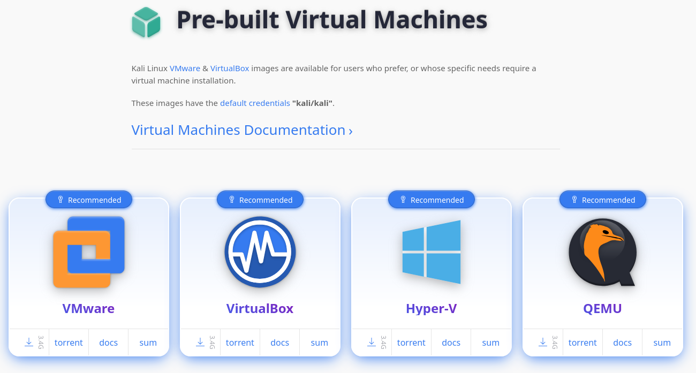

| Hipervisor | Uso típico |
|------------|-----------|
| **VMware** | Workstation/Player, muy extendido en entornos Windows/Linux. |
| **VirtualBox** | Gratuito y multiplataforma; es el que se usa en esta guía. |
| **Hyper-V** | Hipervisor nativo de Windows. |
| **QEMU** | Emulador/hipervisor habitual en entornos Linux. |

> **Importante:** Estas imágenes preconstruidas tienen las credenciales por defecto **`kali` / `kali`**. Es fundamental cambiar la contraseña nada más arrancar la máquina (lo veremos en la sección 7).

Se descarga un archivador `.7z`:


Al descomprimir el archivo `.7z` se obtiene una carpeta de nombre `kali-linux-2025.3-virtualbox-amd64` en cuyo interior aparece un archivo de definición de máquina virtual (`.vbox`) y una imagen de disco duro virtual (`.vdi`):

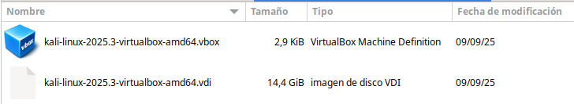

| Fichero | Tipo | Descripción |
|---------|------|-------------|
| `*.vbox` | VirtualBox Machine Definition | Fichero XML con la configuración de la máquina virtual (hardware, red, etc.). |
| `*.vdi` | Imagen de disco VDI | Contiene el sistema de ficheros completo de Kali ya instalado. |

> **Nota:** Se recomienda mover esta carpeta `kali-linux-2025.3-virtualbox-amd64` a la carpeta donde se guardan las máquinas virtuales, para tener todo más organizado. En VirtualBox esa ubicación se puede consultar en *Menú Archivo --> General --> Default Machine Folder*.

---

## 3. Importación en VirtualBox

Una vez en la ubicación deseada, al pulsar en `kali-linux-2025.3-virtualbox-amd64.vbox` se abrirá VirtualBox con la nueva máquina virtual ya añadida a la lista:

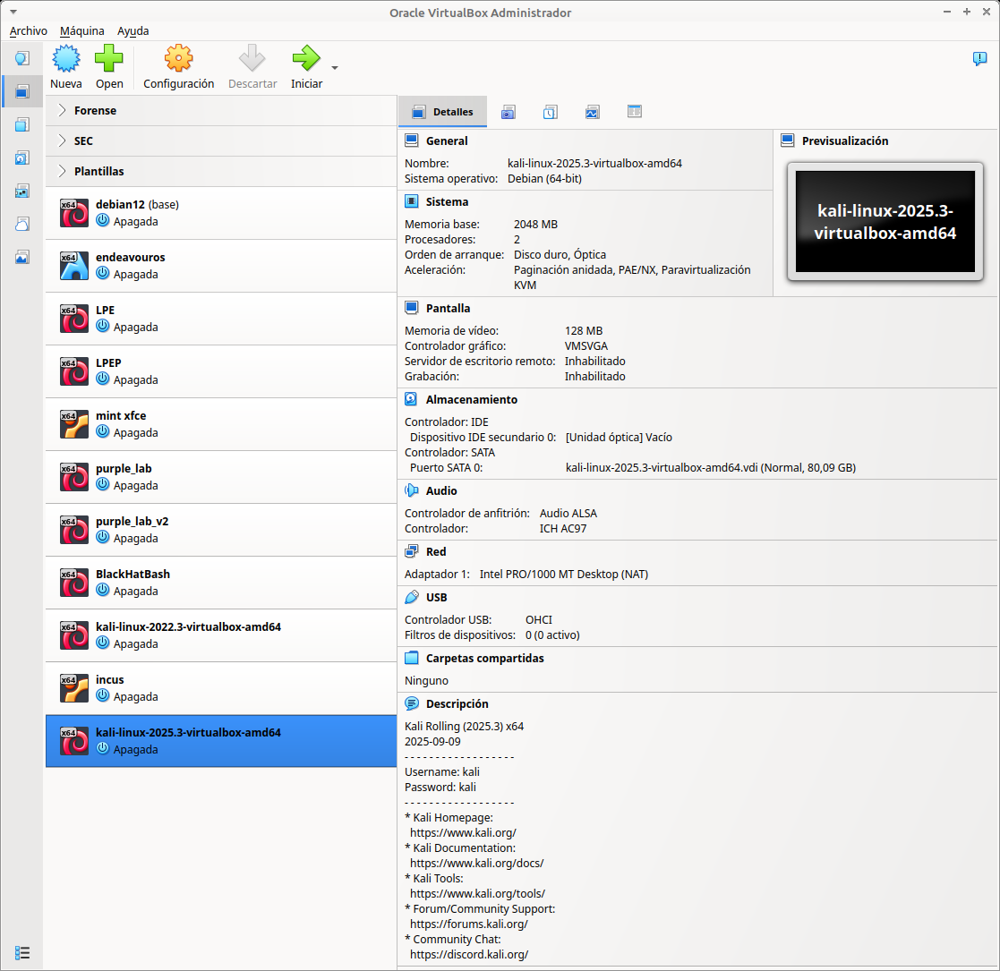

> **Nota:** El panel de **Descripción** de la máquina recoge ya las credenciales por defecto y los enlaces de referencia del proyecto: la [documentación oficial](https://www.kali.org/docs/), el [catálogo de herramientas](https://www.kali.org/tools/) y el [foro/soporte de la comunidad](https://forums.kali.org/).

---

## 4. Configuración de la máquina virtual

Antes de arrancarla, conviene revisar las opciones de importación (CPUs, RAM, red...) y personalizarlas en base a las preferencias y los recursos del equipo anfitrión. A modo de ejemplo se configuran **4 CPUs y 4 GB de RAM**, de sobra para todas las prácticas del curso:

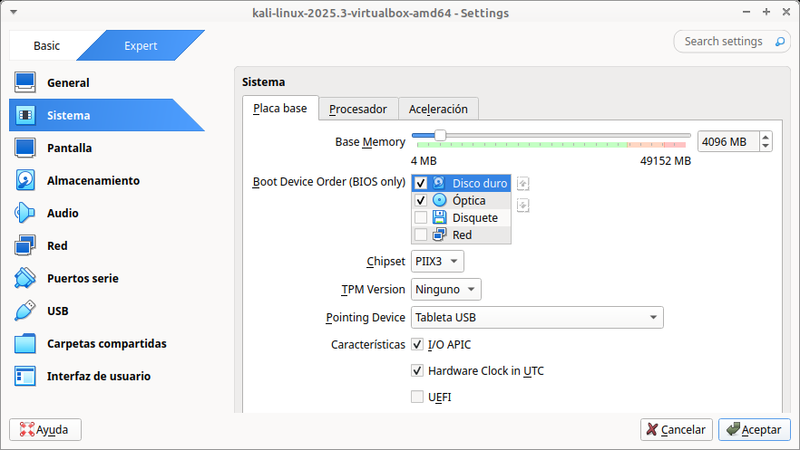

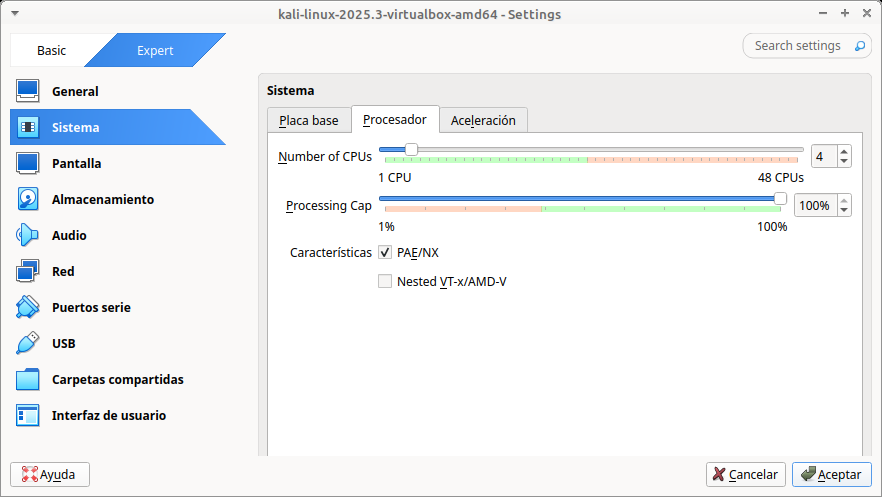

| Parámetro | Descripción |
|-----------|-------------|
| **Base Memory** | Memoria RAM asignada a la máquina virtual (aquí 4096 MB / 4 GB). |
| **Number of CPUs** | Número de núcleos de procesador asignados (aquí 4). |
| **Processing Cap** | Porcentaje máximo de uso de CPU del anfitrión que puede consumir la máquina virtual. |

> **Recuerda:** Estos valores se deben ajustar siempre en función de los recursos reales del equipo anfitrión, dejando margen suficiente para que el sistema operativo base siga funcionando con fluidez.

A continuación se selecciona el modo de red, por ejemplo **Red NAT**, para tener acceso a Internet y que las distintas máquinas virtuales del laboratorio se puedan conectar entre sí a través de esa misma red NAT:

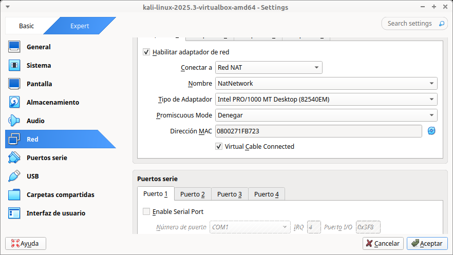

| Parámetro | Descripción |
|-----------|-------------|
| **Conectar a: Red NAT** | Modo de red que da salida a Internet a la máquina virtual y permite que varias VMs conectadas a la misma red NAT se vean entre sí. |
| **Nombre: NatNetwork** | Nombre de la red NAT interna de VirtualBox a la que se conecta el adaptador. |
| **Tipo de Adaptador** | Modelo de tarjeta de red virtual emulada (aquí Intel PRO/1000 MT Desktop). |

> **Nota:** El modo **Red NAT** (distinto del modo *NAT* simple) es el que permite que varias máquinas virtuales compartan la misma red interna y se comuniquen entre sí, algo imprescindible quando se despliegan laboratorios con varias máquinas (por ejemplo, Kali atacando a otra VM vulnerable).

---

## 5. Primer arranque y acceso

Iniciamos la máquina virtual y accedemos con las credenciales **`kali` / `kali`**:


> **Nota:** Las extensiones de VirtualBox (*Guest Additions*) ya están instaladas en la máquina virtual por lo que se pueden usar funcionalidades como el portapapeles compartido y el autorredimensionado de la pantalla del invitado sin pasos adicionales.

---

## 6. Primeros pasos

### Teclado e idioma

En el menú de inicio buscamos `keyboard` y lo configuramos para idioma español:

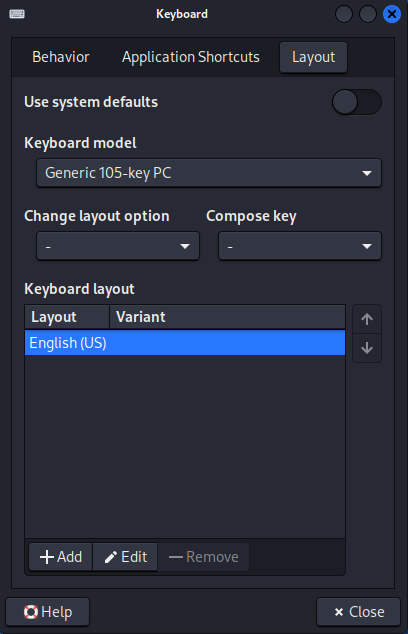

- Pulsar en **+Add** y seleccionar **Español**:

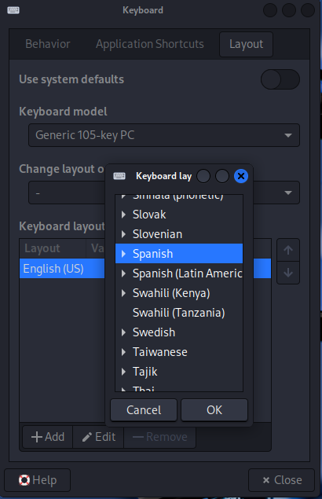

Tras añadirlo, ambas distribuciones aparecen listadas:


- Eliminar **English (US)** seleccionándolo y pulsando **-Remove**:

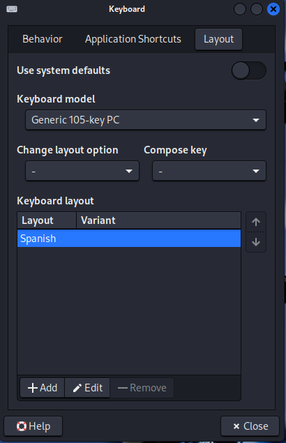

> **Nota:** Este diálogo gráfico (`gnome-control-center` / *Keyboard Settings*) cambia la distribución de teclado de la **sesión gráfica**. Para que el idioma del propio **entorno** (menús, mensajes del sistema) cambie también, hace falta reconfigurar los *locales* desde la terminal.

Para cambiar el idioma del entorno ejecutamos en la terminal:

```bash
┌──(kali㉿kali)-[~]
└─$ sudo dpkg-reconfigure locales
[sudo] password for kali:
....
[*] es_ES.UTF-8 UTF-8
....

┌──(kali㉿kali)-[~]
└─$ date
Sat Oct 11 12:22:48 PM CEST 2025
```

| Comando | Descripción |
|---------|-------------|
| `sudo dpkg-reconfigure locales` | Relanza el asistente de configuración de *locales* (idioma/región del sistema). En el listado marcamos con `[*]` el locale deseado, en este caso `es_ES.UTF-8 UTF-8`. |
| `date` | Muestra la fecha y hora actuales del sistema; sirve aquí para comprobar el resultado tras el cambio. |

### Zona horaria

Para cambiar la zona horaria:

```bash
┌──(kali㉿kali)-[~]
└─$ sudo timedatectl set-timezone Europe/Madrid
[sudo] password for kali:

┌──(kali㉿kali)-[~]
└─$ date
Sat Oct 11 12:22:48 PM CEST 2025
```

| Comando | Descripción |
|---------|-------------|
| `sudo timedatectl set-timezone Europe/Madrid` | Establece la zona horaria del sistema a la indicada (`Europe/Madrid`), usando el formato de la base de datos de zonas horarias `tz`. |
| `date` | Confirma el cambio mostrando la hora ya ajustada (aquí en horario CEST, de verano en Madrid). |

> **Recuerda:** Para listar las zonas horarias disponibles se puede usar `timedatectl list-timezones`.

---

## 7. Usuario kali y cambio de contraseña

Usamos el comando `passwd` para cambiar la contraseña por defecto:

```bash
┌──(kali㉿kali)-[~]
└─$ passwd
Cambiando la contraseña de kali.
Contraseña actual:
Nueva contraseña:
Vuelva a escribir la nueva contraseña:
passwd: contraseña actualizada correctamente
```

| Comando | Descripción |
|---------|-------------|
| `passwd` | Cambia la contraseña del usuario actual. Pide primero la contraseña actual y después la nueva (dos veces, para confirmarla). |

> **Importante:** Cambiar la contraseña por defecto `kali` es el primer paso de seguridad al desplegar la máquina, especialmente si en algún momento va a estar expuesta en una red compartida.

Para ejecutar comandos que necesiten privilegios de administrador se ejecutarán con `sudo`:

```bash
┌──(kali㉿kali)-[~]
└─$ whoami
kali

┌──(kali㉿kali)-[~]
└─$ sudo whoami
[sudo] contraseña para kali:
root
```

| Comando | Descripción |
|---------|-------------|
| `whoami` | Muestra el usuario con el que se está ejecutando la sesión actual. |
| `sudo whoami` | Ejecuta el mismo comando, pero elevando privilegios con `sudo`; el resultado pasa de `kali` a `root`. |

> **Nota:** A diferencia de otras distribuciones, en Kali Linux el usuario `kali` (creado por defecto en las imágenes preconstruidas) pertenece al grupo `sudo`, por lo que puede ejecutar comandos como administrador anteponiendo `sudo`, sin necesidad de iniciar sesión directamente como `root`.

---

## 8. Configuración de red

Se configura la red para el laboratorio a través del asistente gráfico:

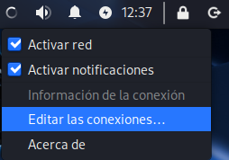

Al pulsar en **Editar las conexiones...** se abre el gestor de conexiones:

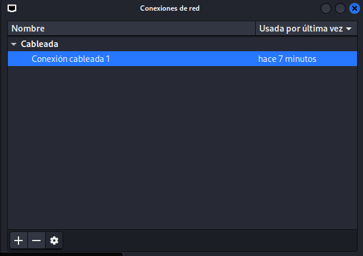

Seleccionamos la conexión y editamos los ajustes de IPv4 para asignar una configuración manual:

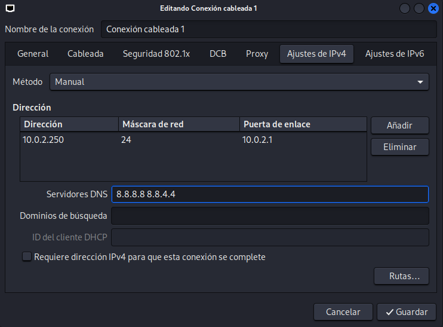

| Campo | Descripción |
|-------|-------------|
| **Método: Manual** | Desactiva el DHCP automático y permite fijar una IP estática. |
| **Dirección / Máscara de red / Puerta de enlace** | Parámetros de la IP estática: aquí `10.0.2.250/24` con puerta de enlace `10.0.2.1`, valores típicos de la red NAT de VirtualBox. |
| **Servidores DNS** | Servidores DNS a usar para la resolución de nombres; aquí los públicos de Google (`8.8.8.8` y `8.8.4.4`). |

> **Nota:** Fijar una IP estática en el laboratorio evita que la dirección cambie entre reinicios, lo cual es muy práctico cuando otras máquinas del mismo laboratorio (por ejemplo, un objetivo vulnerable) necesitan referenciar la IP de la Kali de forma constante.

---

## 9. Actualización del sistema

Para instalar, actualizar o eliminar software se usa el comando `apt`:

```bash
┌──(kali㉿kali)-[~]
└─$ sudo apt update

┌──(kali㉿kali)-[~]
└─$ sudo apt full-upgrade
```

| Comando | Descripción |
|---------|-------------|
| `sudo apt update` | Actualiza el índice local de paquetes disponibles, consultando los repositorios configurados. No instala nada todavía. |
| `sudo apt full-upgrade` | Instala las versiones más recientes de todos los paquetes instalados, permitiendo además instalar o eliminar dependencias si es necesario (a diferencia de `apt upgrade`, más conservador). |

> **Advertencia:** Durante una actualización es posible encontrarse con errores como `Error: Sub-process /usr/bin/dpkg returned an error code (1)`. Suele deberse a un paquete con la configuración a medias o a una interrupción previa del proceso; normalmente se soluciona repitiendo `sudo apt update && sudo apt full-upgrade`, o ejecutando `sudo dpkg --configure -a` para terminar de configurar los paquetes pendientes.

---

## 10. Habilitar el servicio SSH

En las imágenes preconstruidas de Kali, el paquete `openssh-server` viene instalado pero el servicio está **deshabilitado y apagado** por defecto, para no exponerlo de forma accidental al arrancar la máquina. Habilitarlo permite conectarnos a la Kali por SSH desde el equipo anfitrión o desde otras máquinas del laboratorio, en lugar de depender únicamente de la consola gráfica.

Comprobamos primero el estado actual del servicio:

```bash
┌──(kali㉿kali)-[~]
└─$ sudo systemctl status ssh
○ ssh.service - OpenBSD Secure Shell server
     Loaded: loaded (/usr/lib/systemd/system/ssh.service; disabled; preset: disabled)
     Active: inactive (dead)
```

| Comando | Descripción |
|---------|-------------|
| `sudo systemctl status ssh` | Consulta el estado del servicio `ssh` gestionado por `systemd`: si está `loaded` (cargado), si está `enabled`/`disabled` (arranque automático) y si está `active`/`inactive` (en ejecución en este momento). |

Lo habilitamos para que arranque junto con el sistema y lo iniciamos en el mismo paso:

```bash
┌──(kali㉿kali)-[~]
└─$ sudo systemctl enable --now ssh
Synchronizing state of ssh.service with SysV service script...
Created symlink /etc/systemd/system/sshd.service → /usr/lib/systemd/system/ssh.service.
Created symlink /etc/systemd/system/multi-user.target.wants/ssh.service → /usr/lib/systemd/system/ssh.service.
```

| Parámetro | Descripción |
|-----------|-------------|
| `enable` | Marca el servicio para que arranque automáticamente en los siguientes inicios del sistema (crea los enlaces simbólicos necesarios). |
| `--now` | Además de habilitarlo, lo **arranca inmediatamente**, sin tener que reiniciar la máquina ni ejecutar un segundo comando (`start`). |

Confirmamos que el servicio está escuchando en el puerto 22:

```bash
┌──(kali㉿kali)-[~]
└─$ sudo ss -tlnp | grep ssh
LISTEN 0      128          0.0.0.0:22        0.0.0.0:*    users:(("sshd",pid=1234,fd=3))
LISTEN 0      128             [::]:22           [::]:*    users:(("sshd",pid=1234,fd=4))
```

| Parámetro | Descripción |
|-----------|-------------|
| `ss -tlnp` | Lista los sockets `t` (TCP) en estado `l` (*listening*), sin resolver nombres (`n`) y mostrando el proceso que escucha en cada puerto (`p`). |
| `grep ssh` | Filtra la salida para quedarnos solo con la línea del proceso `sshd`, el demonio del servidor SSH. |

> **Importante — regenerar las claves de host:** las imágenes preconstruidas de Kali son descargadas por miles de personas, y **todas parten de las mismas claves de host SSH** (las claves que identifican al servidor, no las de usuario) si no se regeneran. Usar esas claves por defecto facilita ataques de suplantación del servidor. Antes de exponer el servicio SSH de forma seria, conviene regenerarlas:
> ```bash
> ┌──(kali㉿kali)-[~]
> └─$ sudo rm /etc/ssh/ssh_host_*
> ┌──(kali㉿kali)-[~]
> └─$ sudo dpkg-reconfigure openssh-server
> ┌──(kali㉿kali)-[~]
> └─$ sudo systemctl restart ssh
> ```
> Esto elimina las claves de host existentes y fuerza su regeneración, generando un par de claves único para esta máquina en concreto.

Desde el equipo anfitrión (o cualquier otra máquina de la misma red), ya podemos conectarnos indicando la IP de la Kali (la configurada en la sección 8):

```bash
ssh kali@10.0.2.250
```

> **Recuerda:** Si en algún momento regeneras la máquina virtual desde cero (o restauras un snapshot) y las claves de host cambian, el cliente SSH mostrará el aviso `REMOTE HOST IDENTIFICATION HAS CHANGED!`. Es el comportamiento esperado en un laboratorio; basta con limpiar la entrada antigua de `~/.ssh/known_hosts` en el equipo cliente antes de reconectar.

---

## 11. Instalación/borrado de software

Buscar paquetes e información en los repositorios:

```bash
┌──(kali㉿kali)-[~]
└─$ apt search asciinema
asciinema/kali-rolling 2.4.0-1 all
  Record and share your terminal sessions, the right way

termrec/kali-rolling 0.19-3 amd64
  terminal videos/scripts recorder and player

termtosvg/kali-rolling 1.1.0+dfsg-5 all
  record terminal sessions as standalone SVG animations

teseq/kali-rolling 1.1.1-5 amd64
  utility for rendering terminal typescripts human-readable

tty-record/kali-rolling 0.1.0+git20240821.2a020f5+ds-1+b8 amd64
  Simple tool to record a terminal session

┌──(kali㉿kali)-[~]
└─$ apt show asciinema
Package: asciinema
Version: 2.4.0-1
Priority: optional
Section: utils
Maintainer: gustavo panizzo <gfa@zumbi.com.ar>
Installed-Size: 189 kB
Depends: python3:any, python3-pkg-resources
Homepage: https://asciinema.org
Tag: implemented-in::python, interface::commandline, protocol::http,
 role::program, use::entertaining, use::storing
Download-Size: 74,4 kB
APT-Sources: http://http.kali.org/kali kali-rolling/main amd64 Packages
Description: Record and share your terminal sessions, the right way
 Forget screen recording apps and blurry video. Enjoy a lightweight,
 purely text based approach to terminal recording.
 .
 This package provides a command line recorder for asciinema.org service
 or other instance of asciinema server.
```

| Comando | Descripción |
|---------|-------------|
| `apt search <término>` | Busca en los nombres y descripciones de los paquetes disponibles en los repositorios configurados. Aquí devuelve varios paquetes relacionados con la grabación de sesiones de terminal. |
| `apt show <paquete>` | Muestra información detallada de un paquete concreto: versión, dependencias, tamaño, página web, descripción completa, etc. |

Instalación desde los repositorios oficiales de tres paquetes interesantes: `terminator`, `asciinema` y `tmux` (recomendable hacer un `apt update` para conocer el listado de paquetes disponibles en los repositorios si no se ha hecho recientemente):

```bash
┌──(kali㉿kali)-[~]
└─$ sudo apt update

┌──(kali㉿kali)-[~]
└─$ sudo apt install -y terminator asciinema tmux
```

| Parámetro / paquete | Descripción |
|----------------------|-------------|
| `-y` | Responde automáticamente "sí" a todas las preguntas de confirmación de `apt`, evitando que la instalación se detenga esperando que pulsemos una tecla. Muy útil para instalaciones desatendidas o en scripts. |
| `terminator` | Emulador de terminal que permite dividir la ventana en varios paneles (horizontal y verticalmente), muy útil para tener varias sesiones a la vista simultáneamente. |
| `asciinema` | Herramienta para grabar y compartir sesiones de terminal en formato texto (no vídeo), ideal para documentar prácticas o writeups. |
| `tmux` | Multiplexor de terminal: permite crear, dividir en paneles y gestionar varias sesiones de terminal **persistentes** dentro de una misma ventana, incluso sin tener instalado un entorno gráfico. |

> **Nota:** `tmux` es especialmente útil combinado con **SSH** (sección anterior): si la sesión de `tmux` se lanza dentro de la conexión SSH, el trabajo sigue ejecutándose en el servidor aunque la conexión se corte o cerremos el portátil; basta con volver a conectar por SSH y "reenganchar" (`tmux attach`) para recuperar la sesión exactamente donde se dejó.

Instalando `typora` (un editor de Markdown) añadiendo un repositorio externo:

```bash
┌──(kali㉿kali)-[~]
└─$ curl -fsSL https://downloads.typora.io/typora.gpg | sudo tee /etc/apt/keyrings/typora.gpg > /dev/null

┌──(kali㉿kali)-[~]
└─$ echo "deb [signed-by=/etc/apt/keyrings/typora.gpg] https://downloads.typora.io/linux ./" | sudo tee /etc/apt/sources.list.d/typora.list

deb [signed-by=/etc/apt/keyrings/typora.gpg] https://downloads.typora.io/linux ./
┌──(kali㉿kali)-[~]
└─$ sudo apt update

┌──(kali㉿kali)-[~]
└─$ sudo apt install typora
```

| Comando | Descripción |
|---------|-------------|
| `curl -fsSL ... \| sudo tee /etc/apt/keyrings/typora.gpg > /dev/null` | Descarga la clave GPG pública del repositorio de Typora y la guarda en `/etc/apt/keyrings/`, sin mostrarla por pantalla (`tee ... > /dev/null`). Esta clave permite verificar la autenticidad de los paquetes del repositorio. |
| `echo "deb [signed-by=...] ..." \| sudo tee /etc/apt/sources.list.d/typora.list` | Añade la línea del nuevo repositorio al sistema, indicando con `signed-by` que debe verificarse con la clave descargada en el paso anterior. |
| `sudo apt update` | Vuelve a actualizar el índice de paquetes, esta vez incluyendo ya el nuevo repositorio añadido. |
| `sudo apt install typora` | Instala el paquete, que ya se resuelve desde el repositorio recién configurado. |

> **Importante:** Añadir repositorios de terceros implica confiar en que su clave GPG y sus paquetes son legítimos. Es una práctica habitual (muchos fabricantes de software distribuyen así sus aplicaciones para Debian/Ubuntu/Kali), pero conviene hacerlo solo con fuentes oficiales y de confianza, como se hace aquí con el dominio oficial `downloads.typora.io`.

---

## 12. Carpeta compartida

Ir a *Dispositivos --> Carpetas compartidas --> Preferencias de carpetas compartidas* y crear una carpeta:

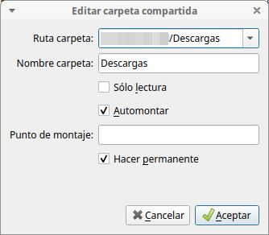

| Campo | Descripción |
|-------|-------------|
| **Ruta carpeta** | Ruta de la carpeta en el sistema anfitrión (host) que se quiere compartir con la máquina virtual. |
| **Nombre carpeta** | Nombre con el que se identificará el recurso compartido dentro de la máquina virtual. |
| **Sólo lectura** | Si se marca, la máquina virtual solo podrá leer el contenido, no modificarlo. |
| **Automontar** | Hace que la carpeta se monte automáticamente al arrancar la máquina virtual, sin tener que montarla a mano. |
| **Hacer permanente** | Guarda la configuración de la carpeta compartida en la definición de la VM, para que persista entre reinicios. |

Añadir el usuario `kali` al grupo `vboxsf` editando `/etc/group` en el caso de que no estuviese ya:

```bash
┌──(kali㉿kali)-[~]
└─$ sudo nano /etc/group
....
kali:x:1000:
vboxsf:x:142:kali
kaboxer:x:143:kali,root
....
```

o con el comando equivalente `sudo usermod -a -G vboxsf kali`:

```bash
┌──(kali㉿kali)-[~]
└─$ sudo usermod -a -G vboxsf kali
```

| Comando | Descripción |
|---------|-------------|
| `sudo nano /etc/group` | Abre el fichero de grupos del sistema con el editor `nano`, para añadir manualmente al usuario `kali` a la lista del grupo `vboxsf`. |
| `sudo usermod -a -G vboxsf kali` | Forma equivalente y más directa de añadir el usuario `kali` al grupo `vboxsf` sin editar el fichero a mano. `-a` (*append*) añade el usuario al grupo sin sacarlo de los demás grupos a los que ya pertenece; `-G` indica el grupo secundario a añadir. |

> **Advertencia:** Es fundamental usar `-a` (*append*) junto a `-G`. Si se omite `-a`, `usermod -G` **sustituye** todos los grupos secundarios del usuario por el indicado, lo que podría quitarle a `kali` otros grupos importantes (como `sudo`).

Como la información sobre los grupos a los que pertenece un usuario se lee en el momento de iniciar la sesión, es necesario salir y volver a entrar. Ahora debería aparecer el recurso compartido:

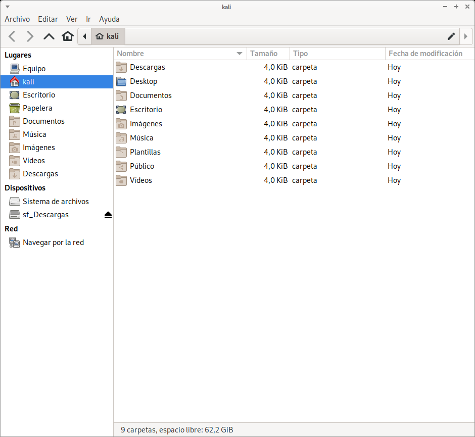

> **Nota:** VirtualBox antepone el prefijo `sf_` (*shared folder*) al nombre configurado para la carpeta compartida; por eso aparece como `sf_Descargas` en el gestor de archivos.

---

## 13. Sistema de ficheros

Kali Linux cumple con el estándar de jerarquía de archivos (**FHS**, *Filesystem Hierarchy Standard*) y los directorios más importantes son:

| Directorio | Usos |
|------------|------|
| `/bin` | Contiene comandos básicos (`cp`, `mv`, `ls`, `rm`, `mkdir`, `cat`, ...). |
| `/sbin` | Contiene comandos de administración del sistema que generalmente usa el administrador (`fdisk`, `iptables`, `sysctl`). |
| `/etc` | Contiene archivos de configuración global que determinan el comportamiento del sistema para todos los usuarios. |
| `/usr/bin` | Contiene aplicaciones como `apt`, `nmap`, `ncat`, ... |
| `/usr/share` | Contiene el `man` y ficheros de apoyo para aplicaciones. |
| `/root` | Directorio personal del superusuario `root`. |
| `/home` | Contiene los directorios personales de los usuarios. |
| `/media` | Usado como punto de montaje para discos duros y dispositivos removibles como USB, CDs, ... |
| `/mnt` | Usado como punto de montaje para sistemas de archivos en red. |

> **Nota:** El estándar FHS es compartido por la inmensa mayoría de distribuciones Linux, no solo Kali. Conocerlo facilita moverse por cualquier sistema Linux, ya que la ubicación de binarios, configuraciones y datos de usuario sigue siempre la misma lógica.

Como ejemplo práctico, `/usr/share` contiene ficheros de apoyo de muchas herramientas de seguridad ya preinstaladas, como las bases de datos y scripts de Nmap:

```bash
┌──(kali㉿kali)-[~]
└─$ ls -lhF /usr/share/nmap
total 9,9M
-rw-r--r-- 1 root root  11K may 15 17:37 nmap.dtd
-rw-r--r-- 1 root root 1,2M may 15 17:37 nmap-mac-prefixes
-rw-r--r-- 1 root root 5,1M may 15 17:37 nmap-os-db
-rw-r--r-- 1 root root 6,7K may 15 17:37 nmap-protocols
-rw-r--r-- 1 root root  43K may 15 17:37 nmap-rpc
-rw-r--r-- 1 root root 2,5M may 15 17:37 nmap-service-probes
-rw-r--r-- 1 root root 975K may 15 17:37 nmap-services
-rw-r--r-- 1 root root  32K may 15 17:37 nmap.xsl
drwxr-xr-x 3 root root 4,0K sep  9 12:14 nselib/
-rw-r--r-- 1 root root  49K may 15 17:37 nse_main.lua
drwxr-xr-x 2 root root  28K sep  9 12:14 scripts/

┌──(kali㉿kali)-[~]
└─$ ls -lhF /usr/share/nmap/scripts
total 4,9M
-rw-r--r-- 1 root root 3,9K may 15 17:37 acarsd-info.nse
-rw-r--r-- 1 root root 8,6K may 15 17:37 address-info.nse
-rw-r--r-- 1 root root 3,3K may 15 17:37 afp-brute.nse
-rw-r--r-- 1 root root 6,4K may 15 17:37 afp-ls.nse
-rw-r--r-- 1 root root 6,9K may 15 17:37 afp-path-vuln.nse
-rw-r--r-- 1 root root 5,5K may 15 17:37 afp-serverinfo.nse
-rw-r--r-- 1 root root 2,6K may 15 17:37 afp-showmount.nse
-rw-r--r-- 1 root root 2,3K may 15 17:37 ajp-auth.nse
-rw-r--r-- 1 root root 3,0K may 15 17:37 ajp-brute.nse
```

| Elemento | Descripción |
|----------|-------------|
| `ls -lhF` | Listado largo (`-l`), con tamaños legibles para humanos (`-h`, *human-readable*) y un carácter indicador de tipo al final de cada entrada (`-F`, por ejemplo `/` para directorios). |
| `/usr/share/nmap` | Contiene las bases de datos que usa Nmap: huellas de sistema operativo (`nmap-os-db`), prefijos de direcciones MAC por fabricante (`nmap-mac-prefixes`), listado de servicios y puertos conocidos (`nmap-services`), etc. |
| `/usr/share/nmap/scripts` | Contiene los scripts del **Nmap Scripting Engine (NSE)**, con extensión `.nse`, usados para tareas de detección y enumeración avanzada (como los vistos en el apartado de enumeración de servicios de estos apuntes). |

También es habitual encontrar en `/usr/share/wordlists` enlaces simbólicos a los diccionarios de las principales herramientas de fuerza bruta instaladas en el sistema:

```bash
┌──(kali㉿kali)-[~]
└─$ ls -lhF /usr/share/wordlists
total 51M
lrwxrwxrwx 1 root root  25 oct 11 13:26 dirb -> /usr/share/dirb/wordlists/
lrwxrwxrwx 1 root root  30 oct 11 13:26 dirbuster -> /usr/share/dirbuster/wordlists/
lrwxrwxrwx 1 root root  35 oct 11 13:26 dnsmap.txt -> /usr/share/dnsmap/wordlist_TLAs.txt
lrwxrwxrwx 1 root root  41 oct 11 13:26 fasttrack.txt -> /usr/share/set/src/fasttrack/wordlist.txt
lrwxrwxrwx 1 root root  45 oct 11 13:26 fern-wifi -> /usr/share/fern-wifi-cracker/extras/wordlists/
lrwxrwxrwx 1 root root  28 oct 11 13:26 john.lst -> /usr/share/john/password.lst
lrwxrwxrwx 1 root root  27 oct 11 13:26 legion -> /usr/share/legion/wordlists/
lrwxrwxrwx 1 root root  46 oct 11 13:26 metasploit -> /usr/share/metasploit-framework/data/wordlists/
lrwxrwxrwx 1 root root  41 oct 11 13:26 nmap.lst -> /usr/share/nmap/nselib/data/passwords.lst
```

| Elemento | Descripción |
|----------|-------------|
| `lrwxrwxrwx` | El primer carácter `l` indica que la entrada es un **enlace simbólico** (*symlink*), no un fichero real. |
| `dirb -> /usr/share/dirb/wordlists/` | El enlace `dirb` apunta a la carpeta de diccionarios real del paquete `dirb`. Así, todas las wordlists quedan accesibles desde un único directorio centralizado (`/usr/share/wordlists`), sin duplicar los ficheros. |
| `john.lst -> /usr/share/john/password.lst` | Ejemplo de enlace al diccionario de contraseñas de **John the Ripper**, uno de los más usados en pruebas de fuerza bruta (como las vistas con Hydra en los apuntes de enumeración de servicios). |

> **Nota:** Esta carpeta centralizada de *wordlists* es muy útil en el día a día: en lugar de recordar la ruta exacta de cada herramienta, basta con mirar en `/usr/share/wordlists` para encontrar el diccionario adecuado (contraseñas, directorios web, subdominios, etc.).
