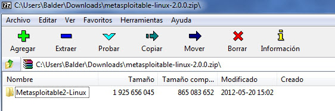
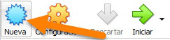
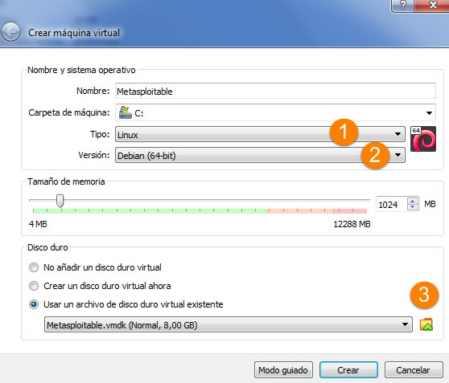
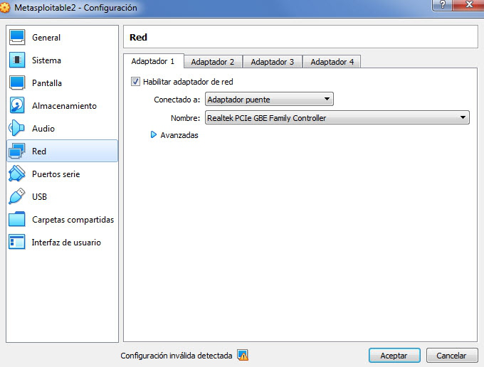
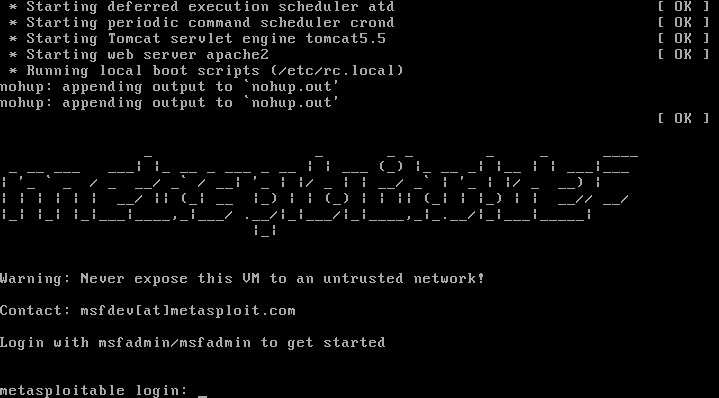
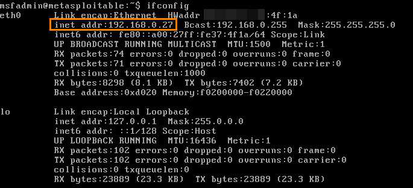

# Instalación de Metasploitable 2

## Índice

1. [Introducción](#1-introducción)
2. [Descarga del paquete](#2-descarga-del-paquete)
3. [Creación de la máquina virtual](#3-creación-de-la-máquina-virtual)
4. [Configuración de red](#4-configuración-de-red)
5. [Primer arranque y acceso](#5-primer-arranque-y-acceso)
6. [Comprobación de la IP](#6-comprobación-de-la-ip)

---

## 1. Introducción

**Metasploitable 2** es una máquina virtual Linux **intencionadamente vulnerable**. A diferencia de Kali Linux (la máquina *atacante*, con las herramientas de auditoría), Metasploitable 2 es la máquina **objetivo**: viene cargada de servicios mal configurados y versiones de software con vulnerabilidades conocidas, pensada específicamente para practicar técnicas de pruebas de penetración contra ella.

El usuario y la contraseña por defecto son **`msfadmin` / `msfadmin`**.

> **Advertencia:** Nunca se debe exponer esta máquina virtual a una red no fiable, y mucho menos hacerla accesible desde Internet. Al estar llena de vulnerabilidades deliberadas, cualquiera en la misma red podría comprometerla en cuestión de minutos. Debe usarse siempre aislada, dentro del laboratorio de prácticas.

---

## 2. Descarga del paquete

Esta máquina está disponible para su descarga en SourceForge:

[sourceforge.net/projects/metasploitable/files/Metasploitable2/](https://sourceforge.net/projects/metasploitable/files/Metasploitable2/)

Viene empaquetada en un `.zip`, que hay que descomprimir:



| Elemento | Descripción |
|----------|-------------|
| `metasploitable-linux-2.0.0.zip` | Archivo comprimido descargado desde SourceForge. |
| `Metasploitable2-Linux/` | Carpeta resultante al descomprimir, con un tamaño sin comprimir de unos 1,9 GB. |

> **Importante:** A diferencia de las imágenes de Kali Linux (que vimos en el [apunte de instalación de Kali](../../Kali%20Linux/00_instalacion.md)), Metasploitable 2 **no** se distribuye como `.ova` ni como `.vbox` + `.vdi` listos para importar. En su lugar, el `.zip` contiene directamente un **disco duro virtual** (`.vmdk`). Por eso el proceso de instalación es distinto: no hay nada que "importar", sino que hay que **crear la máquina virtual desde cero y asociarle ese disco**, exactamente la misma técnica que vimos para reaprovechar el disco extraído de una `.ova`.

---

## 3. Creación de la máquina virtual

Al no existir un fichero de definición de máquina que importar, creamos una máquina virtual nueva en VirtualBox pulsando en **Nueva**:



Indicamos los siguientes parámetros:

1. **Tipo** (sistema operativo): `Linux`.
2. **Versión**: `Debian de 64 bits`.
3. **Disco duro**: seleccionamos **"Usar un archivo de disco duro virtual existente"** y elegimos el fichero `.vmdk` que acabamos de descomprimir.



| Campo | Descripción |
|-------|-------------|
| **Nombre** | Nombre identificativo de la máquina virtual (aquí `Metasploitable`). |
| **Tipo / Versión** | `Linux` / `Debian (64-bit)`. Metasploitable 2 está basada en Ubuntu 8.04, pero al no existir esa versión concreta en la lista de VirtualBox, se usa el tipo genérico `Debian` (misma familia de distribución). |
| **Tamaño de memoria** | RAM asignada a la VM; `1024 MB` es suficiente, ya que Metasploitable 2 es una distribución ligera pensada para 2012. |
| **Usar un archivo de disco duro virtual existente** | En lugar de crear un disco nuevo vacío, se reutiliza el `.vmdk` ya descomprimido como disco de la máquina. |

> **Nota:** Esta es exactamente la técnica de *"crear una VM nueva y añadirle un disco ya existente"* que vimos al hablar de los ficheros `.ova`: el disco (`.vmdk`) trae ya el sistema operativo instalado y configurado; solo hace falta construir el "contenedor" (la definición de la VM: CPU, RAM, red) alrededor de él.

---

## 4. Configuración de red

La configuración de red es indiferente; se puede dejar lo que resulte más cómodo para cada uno. En caso de no tener preferencias, una opción es ponerla en **modo puente** (*bridge*) para que esté en la misma red que el equipo anfitrión (esto dará más juego en algunas prácticas futuras, al poder acceder a la máquina desde otros dispositivos de la red):



| Campo | Descripción |
|-------|-------------|
| **Conectado a: Adaptador puente** | Modo de red *bridge*: la máquina virtual obtiene una IP de la misma red física que el equipo anfitrión, como si fuera un dispositivo más conectado al router. |
| **Nombre** | La tarjeta de red física del anfitrión a través de la cual se "puentea" el tráfico (aquí una Realtek PCIe GBE Family Controller, es decir, el adaptador Ethernet del equipo). |

> **Nota:** El aviso **"Configuración inválida detectada"** que aparece en la captura ocurre cuando el adaptador físico seleccionado en el desplegable **Nombre** no coincide con un adaptador real y activo del equipo en ese momento (por ejemplo, al mover la VM a otro equipo con una tarjeta de red distinta). Si aparece ese aviso, basta con desplegar la lista **Nombre** y elegir el adaptador de red que esté realmente en uso (cableado o Wi-Fi) en la máquina donde se está trabajando.

> **Recuerda:** Si en el laboratorio se prefiere aislar Metasploitable junto con Kali en una red interna propia (en lugar de exponerla en la red física del anfitrión), se puede usar en su lugar el modo **Red NAT** visto en el apunte de instalación de Kali, conectando ambas máquinas a la misma `NatNetwork`. Dado lo vulnerable que es esta máquina, suele ser la opción más prudente.

---

## 5. Primer arranque y acceso

Al iniciar la máquina aparecerá una interfaz en modo texto con el siguiente aspecto:



| Elemento de la pantalla | Descripción |
|--------------------------|-------------|
| `Starting ... atd / crond / Tomcat / apache2` | Servicios que arrancan automáticamente al iniciar la máquina: un servidor web Apache, un contenedor Tomcat, y los planificadores de tareas `atd`/`crond`. Varios de estos servicios son precisamente los que luego se auditarán y explotarán. |
| `Warning: Never expose this VM to an untrusted network!` | El propio sistema recuerda en el arranque la misma advertencia de seguridad de la introducción. |
| `metasploitable login:` | Prompt de acceso, donde se introducen las credenciales por defecto. |

Accedemos con las credenciales **`msfadmin` / `msfadmin`**:



---

## 6. Comprobación de la IP

Una vez dentro, ejecutamos `ifconfig` para consultar la dirección IP asignada a la máquina:

```bash
msfadmin@metasploitable:~$ ifconfig
eth0      Link encap:Ethernet  HWaddr ...:4f:1a
          inet addr:192.168.0.27  Bcast:192.168.0.255  Mask:255.255.255.0
          inet6 addr: fe80::a00:27ff:fe37:4f1a/64 Scope:Link
          UP BROADCAST RUNNING MULTICAST  MTU:1500  Metric:1
          RX packets:74 errors:0 dropped:0 overruns:0 frame:0
          TX packets:71 errors:0 dropped:0 overruns:0 carrier:0
          collisions:0 txqueuelen:1000
          RX bytes:8298 (8.1 KB)  TX bytes:7402 (7.2 KB)
          Base address:0xd020 Memory:f0200000-f0220000

lo        Link encap:Local Loopback
          inet addr:127.0.0.1  Mask:255.0.0.0
          inet6 addr: ::1/128 Scope:Host
          UP LOOPBACK RUNNING   MTU:16436  Metric:1
          RX packets:102 errors:0 dropped:0 overruns:0 frame:0
          TX packets:102 errors:0 dropped:0 overruns:0 carrier:0
          collisions:0 txqueuelen:0
          RX bytes:23889 (23.3 KB)  TX bytes:23889 (23.3 KB)
```

| Comando | Descripción |
|---------|-------------|
| `ifconfig` | Herramienta clásica (en desuso en distribuciones modernas a favor de `ip addr`) para consultar y configurar las interfaces de red. Aquí se usa solo para consulta. |
| `eth0` | Interfaz de red Ethernet principal de la máquina. |
| `inet addr:192.168.0.27` | Dirección IPv4 asignada a la máquina en la red configurada (modo puente, en este ejemplo). |
| `lo` | Interfaz de *loopback* (`127.0.0.1`), interna a la propia máquina. |

Podemos consultar la IP así, aunque también podríamos obtenerla escaneando la red (por ejemplo con `nmap -sn <red>/24` desde la Kali); esto nos sirve como comprobación directa de que la máquina ha arrancado correctamente y tiene conectividad.

> **Nota:** Esta IP (`192.168.0.27`) es la que se usará como objetivo desde Kali Linux en las siguientes prácticas de enumeración y explotación de servicios de esta máquina.
